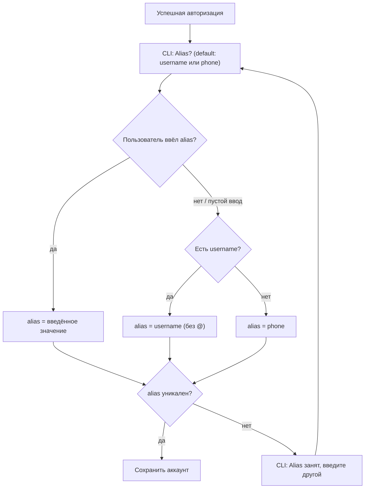

# Account

Представляет залогиненный Telegram-аккаунт пользователя.

## Поля

| Поле | Тип | Описание |
|---|---|---|
| id | number | Telegram user ID |
| phone | string | Номер телефона в международном формате (например, `+79001234567`) |
| firstName | string | Имя пользователя в Telegram |
| lastName | string \| null | Фамилия пользователя (может отсутствовать) |
| username | string \| null | Username без `@` (может отсутствовать) |
| alias | string | Короткое имя аккаунта для использования в CLI |
| isDefault | boolean | Является ли аккаунт активным по умолчанию |

## Alias

Alias — основной идентификатор аккаунта в CLI. Используется во всех командах вместо номера телефона.

### Резолвинг alias при авторизации

### Правила

- Alias уникален среди всех залогиненных аккаунтов.
- Если пользователь вводит alias, который уже занят — CLI просит ввести другой.
- Alias может содержать только латинские буквы, цифры, дефис и подчёркивание (`[a-zA-Z0-9_-]+`). Исключение: автоматический alias из номера телефона — допускает `+` и цифры.
- Alias можно изменить позже через `tg accounts rename <old> <new>`.

## Бизнес-правила

- В системе может быть только один аккаунт с `isDefault = true` в любой момент времени.
- При добавлении первого аккаунта он автоматически становится default.
- При удалении default-аккаунта ни один другой аккаунт автоматически не становится default — пользователь должен выбрать вручную.
- `phone` уникален — нельзя залогинить один и тот же номер дважды.
- `alias` уникален — нельзя иметь два аккаунта с одинаковым alias.
