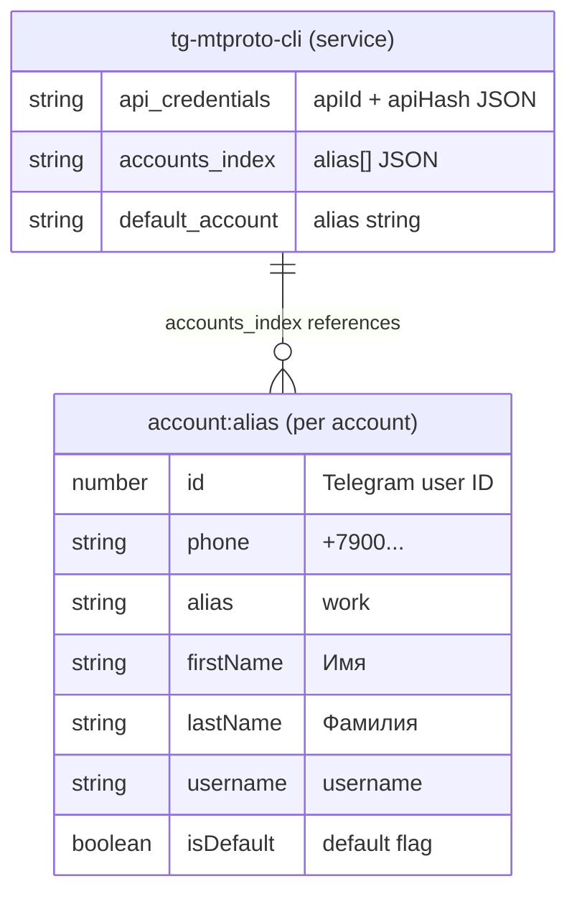

# Credential Storage

Хранение метаданных аккаунтов и конфигурации приложения через системное хранилище (cross-keychain).

## Порт (интерфейс)

```typescript
type CredentialStorage = {
  getAccounts(): Promise<Account[]>
  getAccountByAlias(alias: string): Promise<Account | null>
  getDefaultAccount(): Promise<Account | null>
  saveAccount(account: Account): Promise<void>
  removeAccount(alias: string): Promise<void>
  setDefault(alias: string): Promise<void>
  isAliasAvailable(alias: string): Promise<boolean>
  renameAlias(oldAlias: string, newAlias: string): Promise<void>
  getApiCredentials(): Promise<{ apiId: number; apiHash: string } | null>
  saveApiCredentials(apiId: number, apiHash: string): Promise<void>
}
```

## Адаптер: KeychainCredentialStorage

Реализация через npm-пакет `cross-keychain`.

### Service name

Все записи хранятся под сервисом `tg-mtproto-cli`.

### Структура хранения

cross-keychain оперирует парами `(service, account) -> password`. Используются следующие account-ключи:



| Account (ключ keytar) | Содержимое (value) | Описание |
|---|---|---|
| `api_credentials` | `{"apiId": 12345, "apiHash": "abc..."}` | API-ключи Telegram |
| `accounts_index` | `["work", "personal"]` | Список alias-ов залогиненных аккаунтов |
| `account:<alias>` | `{"id": 123, "phone": "+7...", "alias": "work", "firstName": "...", ...}` | Метаданные конкретного аккаунта |
| `default_account` | `"work"` | Alias default-аккаунта |

### Формат данных

Все значения хранятся как JSON-строки в поле password cross-keychain. При чтении — парсятся из JSON; при записи — сериализуются в JSON.

### API Credentials

`apiId` и `apiHash` — ключи Telegram API, необходимые для создания mtcute-клиента. Запрашиваются у пользователя один раз при первом `tg auth` и сохраняются навсегда. Получить их можно на https://my.telegram.org.

### Атомарность

При обновлении аккаунта (например, setDefault) необходимо обновить и `account:<alias>` для старого и нового default, и `default_account`. Если одна из записей не обновится — при следующем запуске состояние восстановится из `default_account` как source of truth.

### Переименование alias

При `renameAlias(old, new)`:
1. Прочитать данные из `account:<old>`.
2. Обновить поле `alias` в данных аккаунта.
3. Записать в `account:<new>`.
4. Удалить `account:<old>`.
5. Обновить `accounts_index` — заменить старый alias на новый.
6. Если аккаунт был default — обновить `default_account`.
