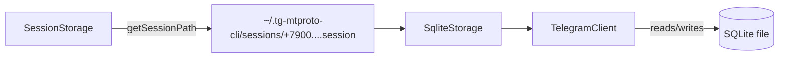

# Session Storage

Управление файлами сессий mtcute (SQLite).

## Порт (интерфейс)

```typescript
type SessionStorage = {
  getSessionPath(phone: string): string
  sessionExists(phone: string): boolean
  removeSession(phone: string): Promise<void>
}
```

## Адаптер: SqliteSessionStorage

### Расположение файлов

Сессии хранятся в директории `~/.tg-mtproto-cli/sessions/`.

Каждый аккаунт — отдельный файл SQLite:

```
~/.tg-mtproto-cli/
└── sessions/
    ├── +79001234567.session
    └── +79007654321.session
```

### Связь с mtcute



При создании `TelegramClient` из `@mtcute/node` путь к файлу сессии передаётся в `SqliteStorage`:

```typescript
new TelegramClient({
  storage: new SqliteStorage(sessionStorage.getSessionPath(phone))
})
```

mtcute самостоятельно управляет содержимым SQLite-файла: auth keys, DC info, update state и т.д.

### Удаление сессии

При logout файл сессии удаляется с диска целиком. Если файл не существует — операция считается успешной (идемпотентность).

### Создание директории

При первом `tg auth` директория `~/.tg-mtproto-cli/sessions/` создаётся автоматически, если не существует.
