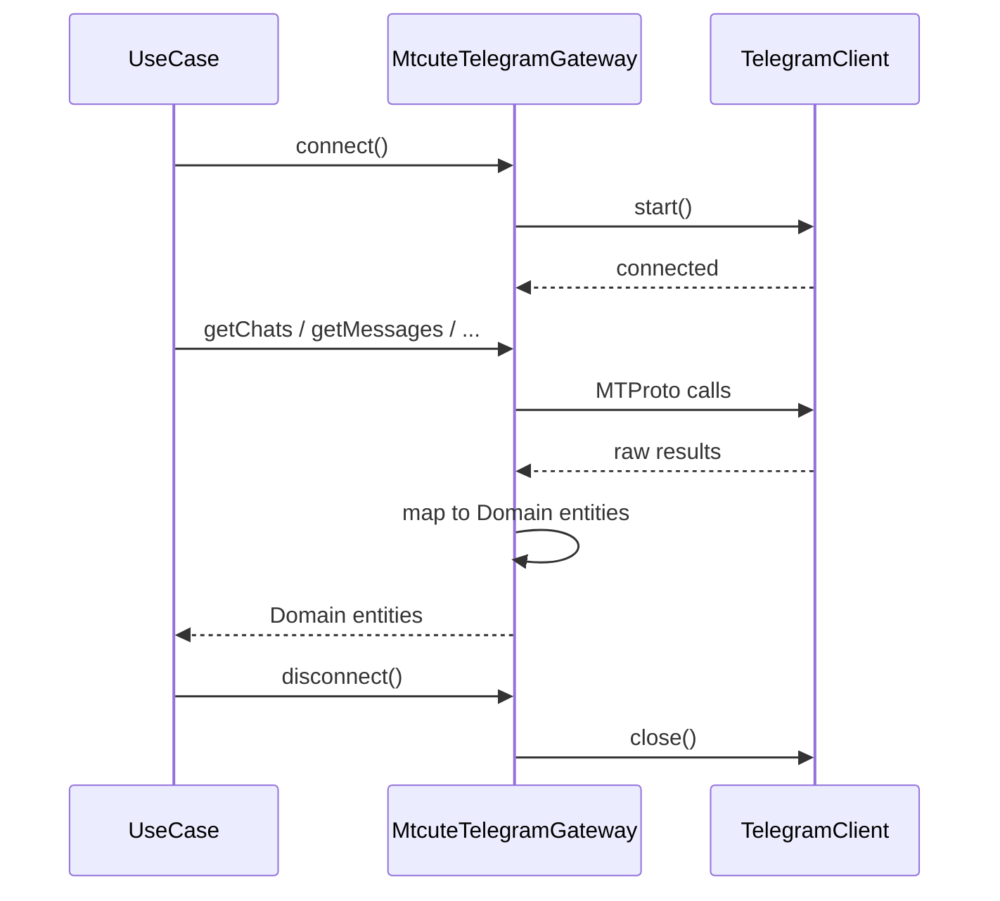
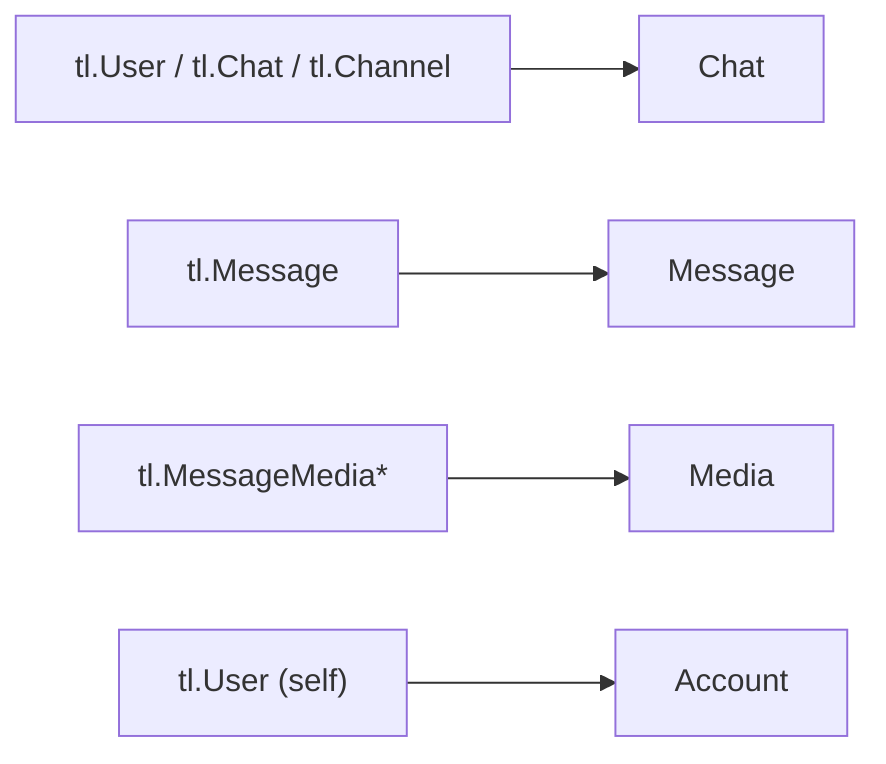

# Telegram Client (TelegramGateway)

Адаптер для взаимодействия с Telegram API через библиотеку `@mtcute/node`.

## Порт (интерфейс)

Use Cases работают через порт `TelegramGateway`, не зная о mtcute напрямую.

```typescript
type TelegramGateway = {
  auth(params: {
    phone: () => Promise<string>
    code: () => Promise<string>
    password: () => Promise<string>
  }): Promise<Account>

  logout(): Promise<void>

  getChats(params: {
    limit: number
    offset: number
    type?: ChatType
  }): Promise<Chat[]>

  getMessages(params: {
    chatId: string | number
    limit: number
    all: boolean
    threadId?: number
    filter?: MessageFilter
    query?: string
    from?: string
    after?: Date
    before?: Date
    onProgress?: (loaded: number) => void
  }): Promise<Message[]>

  downloadMedia(params: {
    chatId: string
    messageId: number
    outputPath: string
    onProgress?: (downloaded: number, total: number) => void
  }): Promise<{ path: string; fileName: string; size: number; mimeType: string }>

  resolveChat(identifier: string): Promise<{ id: number; type: ChatType }>

  connect(): Promise<void>
  disconnect(): Promise<void>
}
```

## Адаптер: MtcuteTelegramGateway

Реализация порта через `@mtcute/node`.

### Создание клиента

Каждый аккаунт получает отдельный экземпляр `TelegramClient` из `@mtcute/node`. Клиент создаётся с:
- `apiId` и `apiHash` из CredentialStorage
- `SqliteStorage` с путём к файлу сессии конкретного аккаунта

### Жизненный цикл



Use Case отвечает за вызов connect/disconnect. Рекомендуемый паттерн:

```typescript
try {
  await gateway.connect()
  const chats = await gateway.getChats({ limit: 50, offset: 0 })
  return chats
} finally {
  await gateway.disconnect()
}
```

### Маппинг mtcute -> Domain



### Фабрика

Gateway создаётся через фабричную функцию, так как каждый аккаунт требует свой экземпляр с уникальными apiId/apiHash и session path:

```typescript
type CreateTelegramGateway = (params: {
  apiId: number
  apiHash: string
  sessionPath: string
}) => TelegramGateway
```

В `main.ts` фабрика передаётся в use cases, которым нужен Telegram (chats, messages, download, auth, logout).

### Резолвинг чатов

Метод `resolveChat` принимает строку и определяет тип идентификатора:
- Числовой ID: используется напрямую
- Username (с или без `@`): резолвится через `client.resolvePeer()`

### Чтение и поиск сообщений

`MessageFilter` принадлежит domain, без импорта mtcute:
`url | photo | video | photo-video | document | gif | voice | audio | video-note | pinned`.
Адаптер переводит его в `SearchFilters.Url/Photo/Video/PhotoAndVideo/Document/Gif/Voice/Audio/Round/Pinned`.
`from` становится `fromUser` (числовая строка преобразуется в число); mtcute
резолвит ID/username и сохраняет исходную ошибку при неудаче.

При topic/filter/query/from вызывается `searchMessages` с явным chatId на каждой
странице; остальные чтения используют `getHistory`. Фильтры не теряются между
страницами. Пустой query с пустым filter не используется для чтения только по датам.
`-n` считает подходящие сообщения, `all` отменяет лимит. Страницы ограничены 100,
идут от новых к старым, короткая страница сама по себе не означает конец. Курсор
берётся из `next`, дубли ID не учитываются, неубывающий курсор вызывает ошибку.
Остановка: N совпадений, исчерпание, нижняя граница; результат разворачивается один раз.

`after` включителен, `before` исключителен. Search получает Date с нижней границей
`(ceil(after_ms / 1000) - 1) * 1000` и верхней `ceil(before_ms / 1000) * 1000`.
History начинает с `{ id: 0, date: ceil(before_ms / 1000) }`, если верхняя граница
задана. Положительный int32 является допустимым серверным диапазоном; внешние
границы опускаются, чтобы mtcute не переполнил timestamp, и проверяются локально.
Точная проверка исходных дат выполняется до подсчёта N, включая дробные секунды.
При before не позже Unix epoch результат пуст, запросы чтения не отправляются.

Общий mapper сохраняет URL-сущности. Вложения не скачиваются; у mtcute
`video.isAnimation` отображается в `animation`, `video.isRound` в `video_note`,
остальные доступные метаданные сохраняются. Ошибки сети и резолвинга не превращаются
в пустой результат. Disconnect выполняется use case через `finally`.
