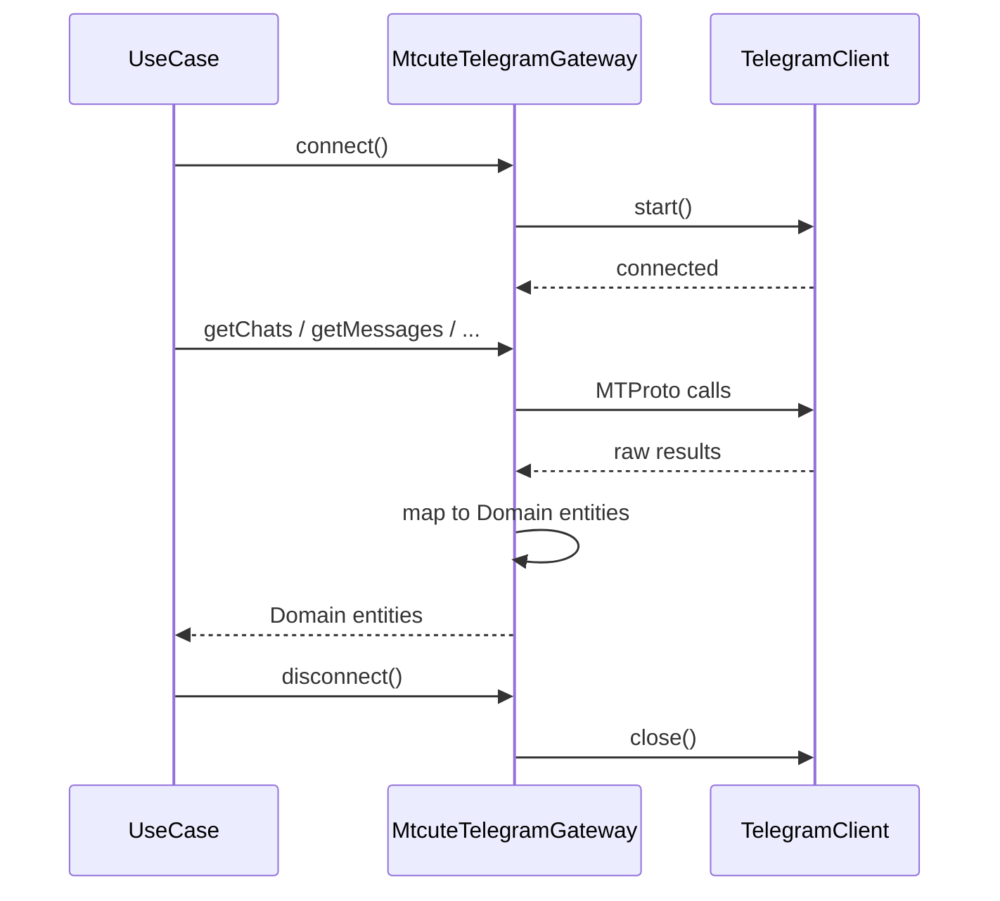
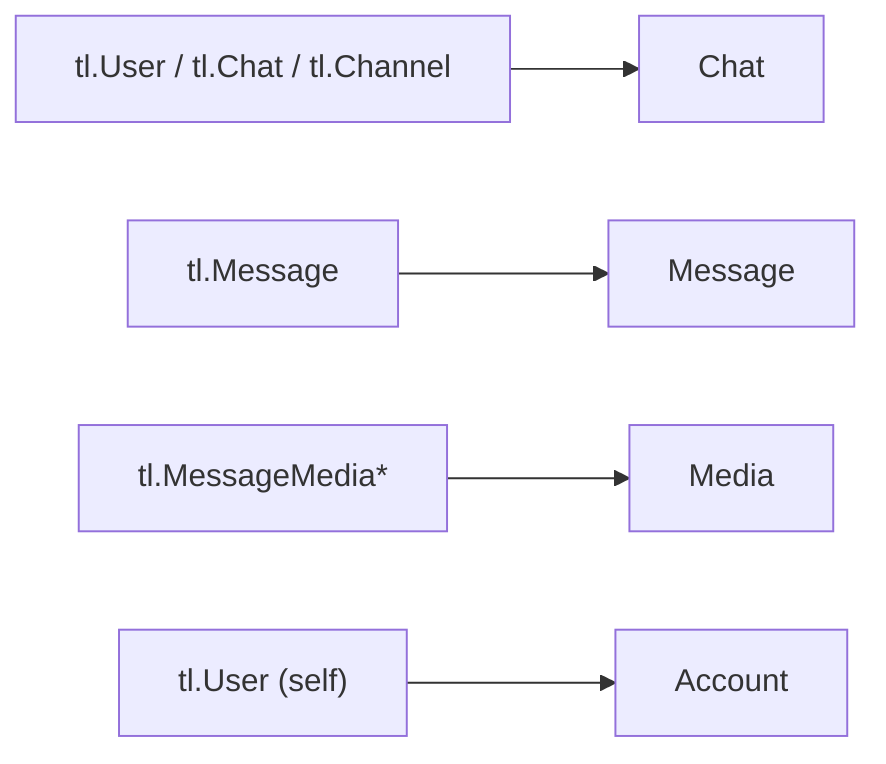

# Telegram Client (TelegramGateway)

Адаптер для взаимодействия с Telegram API через библиотеку `@mtcute/node`.

## Порт (интерфейс)

Use Cases работают через порт `TelegramGateway`, не зная о mtcute напрямую.

```typescript
type TelegramGateway = {
  auth(params: {
    phone: () => Promise<string>
    code: () => Promise<string>
    password: () => Promise<string>
  }): Promise<Account>

  logout(): Promise<void>

  getChats(params: {
    limit: number
    offset: number
    type?: ChatType
  }): Promise<Chat[]>

  getMessages(params: {
    chatId: string
    limit: number
    all: boolean
    onProgress?: (loaded: number) => void
  }): Promise<Message[]>

  downloadMedia(params: {
    chatId: string
    messageId: number
    outputPath: string
    onProgress?: (downloaded: number, total: number) => void
  }): Promise<{ path: string; fileName: string; size: number; mimeType: string }>

  resolveChat(identifier: string): Promise<{ id: number; type: ChatType }>

  connect(): Promise<void>
  disconnect(): Promise<void>
}
```

## Адаптер: MtcuteTelegramGateway

Реализация порта через `@mtcute/node`.

### Создание клиента

Каждый аккаунт получает отдельный экземпляр `TelegramClient` из `@mtcute/node`. Клиент создаётся с:
- `apiId` и `apiHash` из CredentialStorage
- `SqliteStorage` с путём к файлу сессии конкретного аккаунта

### Жизненный цикл



Use Case отвечает за вызов connect/disconnect. Рекомендуемый паттерн:

```typescript
try {
  await gateway.connect()
  const chats = await gateway.getChats({ limit: 50, offset: 0 })
  return chats
} finally {
  await gateway.disconnect()
}
```

### Маппинг mtcute -> Domain



### Фабрика

Gateway создаётся через фабричную функцию, так как каждый аккаунт требует свой экземпляр с уникальными apiId/apiHash и session path:

```typescript
type CreateTelegramGateway = (params: {
  apiId: number
  apiHash: string
  sessionPath: string
}) => TelegramGateway
```

В `main.ts` фабрика передаётся в use cases, которым нужен Telegram (chats, messages, download, auth, logout).

### Резолвинг чатов

Метод `resolveChat` принимает строку и определяет тип идентификатора:
- Числовой ID: используется напрямую
- Username (с или без `@`): резолвится через `client.resolvePeer()`
