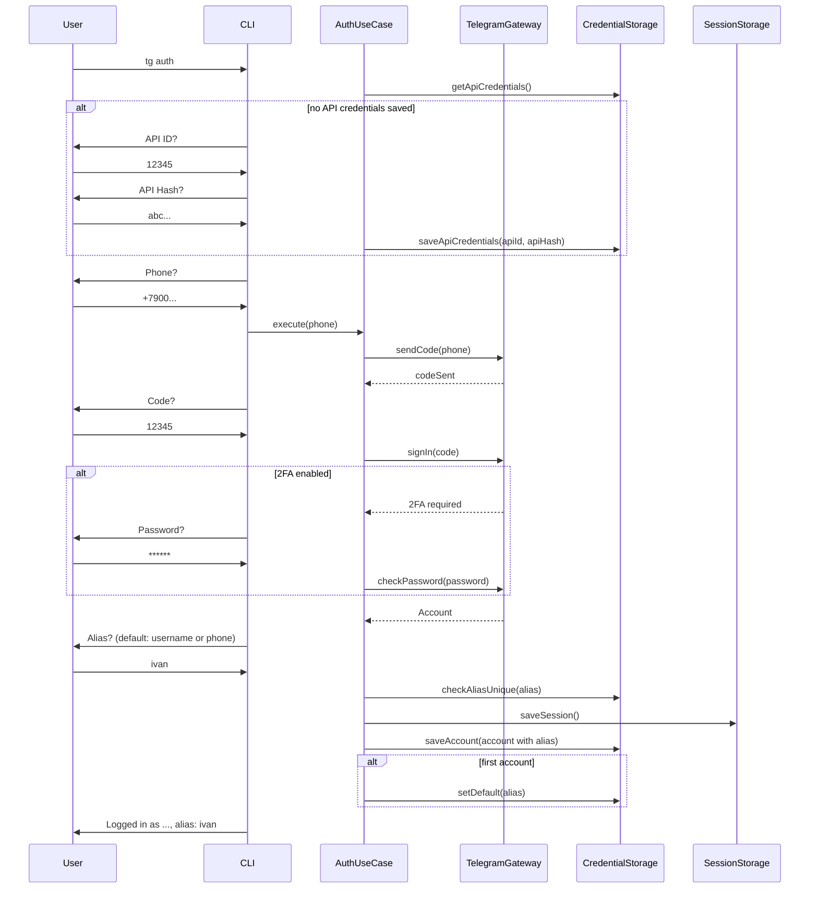

# Auth

Аутентификация пользователя в Telegram по номеру телефона с поддержкой кода подтверждения и 2FA-пароля.

## Команда CLI

```bash
tg auth
```

## Входные параметры

Параметры запрашиваются интерактивно (stdin prompts):

| Параметр | Тип | Описание |
|---|---|---|
| apiId | number | Telegram API ID (запрашивается только при первом запуске) |
| apiHash | string | Telegram API Hash (запрашивается только при первом запуске) |
| phone | string | Номер телефона в международном формате |
| code | string | Код подтверждения из Telegram |
| password | string | 2FA-пароль (запрашивается только при включённой 2FA) |
| alias | string | Короткое имя аккаунта для CLI. Если пустой — берётся username или phone |

## Выходные данные

При успешной аутентификации выводится:

```
Logged in as Иван Иванов (@ivanov), alias: ivan
```

## Основной сценарий



1. Пользователь вводит команду `tg auth`.
2. Use case проверяет наличие API-ключей через CredentialStorage. Если отсутствуют — CLI запрашивает `API ID` и `API Hash` (получить на https://my.telegram.org). Ключи сохраняются навсегда и больше не запрашиваются.
3. CLI запрашивает номер телефона.
4. Use case передаёт номер в TelegramGateway, который отправляет код через Telegram API.
5. CLI запрашивает код подтверждения.
6. Use case передаёт код в TelegramGateway.
7. Если у пользователя включена 2FA — CLI запрашивает пароль, use case передаёт его в TelegramGateway.
8. TelegramGateway возвращает данные авторизованного пользователя.
9. CLI запрашивает alias для аккаунта. Показывает подсказку: `Alias (default: <username или phone>):`. Если пользователь нажимает Enter без ввода — используется username (без `@`), а если username отсутствует — номер телефона.
10. Use case проверяет уникальность alias среди существующих аккаунтов. Если занят — CLI просит ввести другой.
11. Use case сохраняет сессию через SessionStorage.
12. Use case сохраняет метаданные аккаунта (id, phone, name, username, alias) через CredentialStorage.
13. Если это первый аккаунт — автоматически устанавливается как default.
14. CLI выводит подтверждение с указанием alias.

## Ошибки

| Ситуация | Сообщение | Exit code |
|---|---|---|
| Невалидный номер телефона | `Invalid phone number format` | 1 |
| Неверный код подтверждения | `Invalid confirmation code` | 1 |
| Неверный 2FA-пароль | `Invalid 2FA password` | 1 |
| Таймаут ввода кода (120 сек) | `Code input timed out` | 1 |
| Номер уже используется для Flood Wait | `Too many attempts. Try again in X seconds` | 1 |
| Нет соединения с Telegram | `Cannot connect to Telegram servers` | 1 |

## Граничные случаи

- Аккаунт с таким номером уже залогинен: вывести предупреждение `Account "work" (+7900...) is already logged in. Re-authenticate? (y/n)`. При подтверждении — удалить старую сессию и авторизоваться заново. Alias сохраняется прежний, если пользователь не введёт новый.
- Telegram отправляет код не в SMS, а в приложение: CLI отображает `Code was sent to the Telegram app` перед запросом ввода.
- Alias уже занят другим аккаунтом: CLI выводит `Alias "ivan" is already taken. Choose another:` и повторяет запрос.
