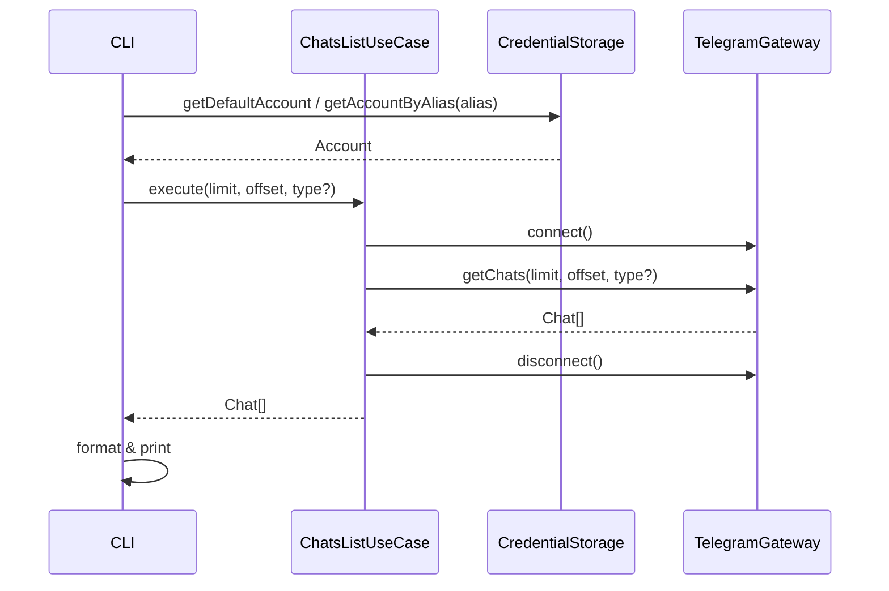

# Chats List

Выводит список чатов текущего пользователя с возможностью фильтрации по типу.

## Команда CLI

```bash
tg chats [--type <type>] [--limit <n>] [--offset <n>]
```

## Входные параметры

| Параметр | Тип | По умолчанию | Описание |
|---|---|---|---|
| --type | string (флаг) | все | Фильтр по типу чата: `private`, `group`, `supergroup`, `channel` |
| --limit | number (флаг) | 50 | Количество чатов для вывода |
| --offset | number (флаг) | 0 | Смещение для пагинации |
| --account | string (глобальный флаг) | default | Alias аккаунта |

## Выходные данные

Таблица чатов:

```
  #  Chat ID          Type         Title                    Unread  Last Activity
  1  123456789        private      Иван Иванов              3       5 min ago
  2  -1001234567890   supergroup   Рабочий чат              12      1 hour ago
  3  -1001987654321   channel      Новости                  —       2 hours ago
```

В JSON-режиме (`--json`):

```json
[
  {
    "id": -1001234567890,
    "type": "supergroup",
    "title": "Рабочий чат",
    "username": "workchat",
    "unreadCount": 12,
    "lastMessage": "Всем привет!",
    "lastActivity": "2026-02-22T10:30:00Z"
  }
]
```

## Основной сценарий



1. Определить активный аккаунт (из `--account` или default).
2. Загрузить сессию через SessionStorage.
3. Подключиться к Telegram через TelegramGateway.
4. Запросить список диалогов с учётом limit и offset.
5. Если указан `--type` — отфильтровать по типу.
6. Преобразовать результат в массив Chat-сущностей.
7. Отформатировать и вывести.

## Ошибки

| Ситуация | Сообщение | Exit code |
|---|---|---|
| Не задан default-аккаунт | `No default account. Use 'tg default <alias>' or --account flag.` | 2 |
| Сессия истекла | `Session expired for "work". Run 'tg auth' to re-authenticate.` | 2 |
| Невалидный --type | `Invalid chat type. Use: private, group, supergroup, channel` | 1 |

## Граничные случаи

- Нет чатов (новый аккаунт): вывести `No chats found.`
- Чат без текста последнего сообщения (например, медиа): отобразить `[Photo]`, `[Document]` и т.д. в колонке Last Message.
