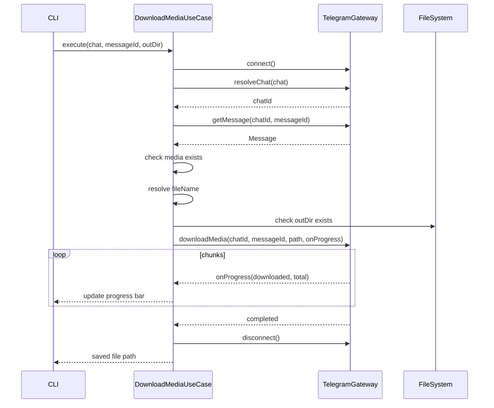

# Download Media

Скачивает медиа-вложение из указанного сообщения.

## Команда CLI

```bash
tg download <chat> <message_id> [--out <dir>]
```

## Входные параметры

| Параметр | Тип | По умолчанию | Описание |
|---|---|---|---|
| chat | string (аргумент) | — | Идентификатор чата: ID, username или @mention |
| message_id | number (аргумент) | — | ID сообщения с медиа |
| --out | string (флаг) | `.` (текущая директория) | Директория для сохранения файла |
| --account | string (глобальный флаг) | default | Alias аккаунта |

## Выходные данные

Прогресс-бар во время скачивания и путь к файлу по завершении:

```
Downloading video.mp4...
[████████████████████░░░░░] 80% 12.3/15.4 MB

Saved to ./video.mp4
```

В JSON-режиме (`--json`):

```json
{
  "path": "/Users/user/downloads/video.mp4",
  "fileName": "video.mp4",
  "size": 16160768,
  "mimeType": "video/mp4"
}
```

## Основной сценарий



1. Определить активный аккаунт.
2. Загрузить сессию, подключиться через TelegramGateway.
3. Резолвить `chat`.
4. Получить сообщение по `message_id`.
5. Проверить наличие медиа-вложения.
6. Определить имя файла: использовать оригинальное имя из Telegram; если отсутствует — сгенерировать из типа и ID (`photo_42.jpg`).
7. Проверить существование `--out` директории.
8. Начать скачивание через TelegramGateway.downloadMedia() с колбэком прогресса.
9. Отображать прогресс-бар в CLI.
10. По завершении вывести путь к сохранённому файлу.

## Поддерживаемые типы медиа

| MediaType | Скачивание |
|---|---|
| photo | Скачивается в максимальном разрешении |
| video | Полный файл |
| document | Полный файл |
| audio | Полный файл |
| voice | Полный файл (.ogg) |
| video_note | Полный файл (.mp4) |
| sticker | В формате .webp |
| animation | В формате .mp4 |

## Ошибки

| Ситуация | Сообщение | Exit code |
|---|---|---|
| Не указан chat или message_id | `Usage: tg download <chat> <message_id> [--out <dir>]` | 1 |
| Чат не найден | `Chat "xxx" not found` | 1 |
| Сообщение не найдено | `Message #42 not found in chat "xxx"` | 1 |
| Сообщение без медиа | `Message #42 has no media attachment` | 1 |
| Директория не существует | `Directory "/path/to/dir" does not exist` | 1 |
| Файл уже существует | Перезаписать без предупреждения |
| Не задан default-аккаунт | `No default account. Use 'tg default <alias>' or --account flag.` | 2 |
| Сессия истекла | `Session expired for "work". Run 'tg auth' to re-authenticate.` | 2 |
| Ошибка сети при скачивании | `Download failed: <reason>. Partial file removed.` | 1 |

## Граничные случаи

- Прерывание скачивания (Ctrl+C): удалить частично скачанный файл.
- Очень большой файл (>2 GB): нет ограничения со стороны CLI, скачивается полностью.
- Сообщение с несколькими медиа (альбом): скачивается первое вложение. Для скачивания конкретного — использовать ID нужного сообщения из альбома.
