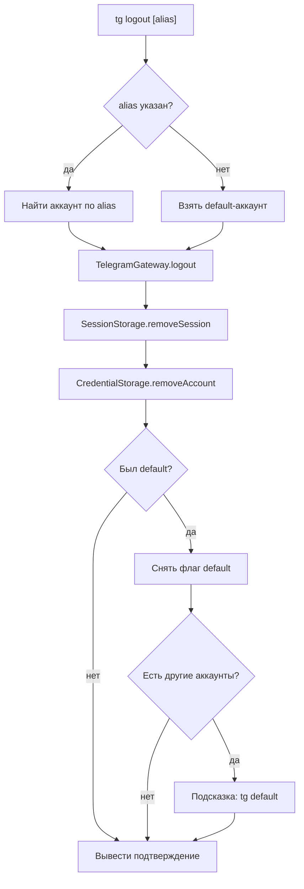

# Logout

Разлогинивает выбранный аккаунт, удаляя сессию и метаданные.

## Команда CLI

```bash
tg logout [alias]
```

## Входные параметры

| Параметр | Тип | Обязательный | Описание |
|---|---|---|---|
| alias | string (аргумент) | Нет | Alias аккаунта для разлогина. Если не указан — разлогинивает default-аккаунт |

## Выходные данные

```
Logged out from "work" (+79001234567, Иван Иванов)
```

## Основной сценарий



1. Определить целевой аккаунт: по аргументу `alias` или default-аккаунт из CredentialStorage.
2. Вызвать TelegramGateway.logout() для завершения сессии на стороне Telegram.
3. Удалить файл сессии через SessionStorage.
4. Удалить метаданные аккаунта из CredentialStorage.
5. Если разлогиненный аккаунт был default — снять флаг. Если остались другие аккаунты, вывести `No default account set. Use 'tg default <alias>' to set one.`
6. Вывести подтверждение.

## Ошибки

| Ситуация | Сообщение | Exit code |
|---|---|---|
| Нет залогиненных аккаунтов | `No accounts found. Use 'tg auth' to log in.` | 2 |
| Аккаунт не найден | `Account "xxx" not found` | 1 |
| Ошибка при завершении сессии на сервере | Вывести предупреждение, но всё равно удалить локальные данные | 0 |

## Граничные случаи

- Не указан alias и нет default-аккаунта: вывести список аккаунтов и попросить указать alias.
- Единственный аккаунт: после разлогина система полностью пуста. Никакие предупреждения не нужны.
- Ошибка связи при logout на сервере: локальная сессия всё равно удаляется, выводится предупреждение `Warning: Could not terminate remote session. Local session removed.`
