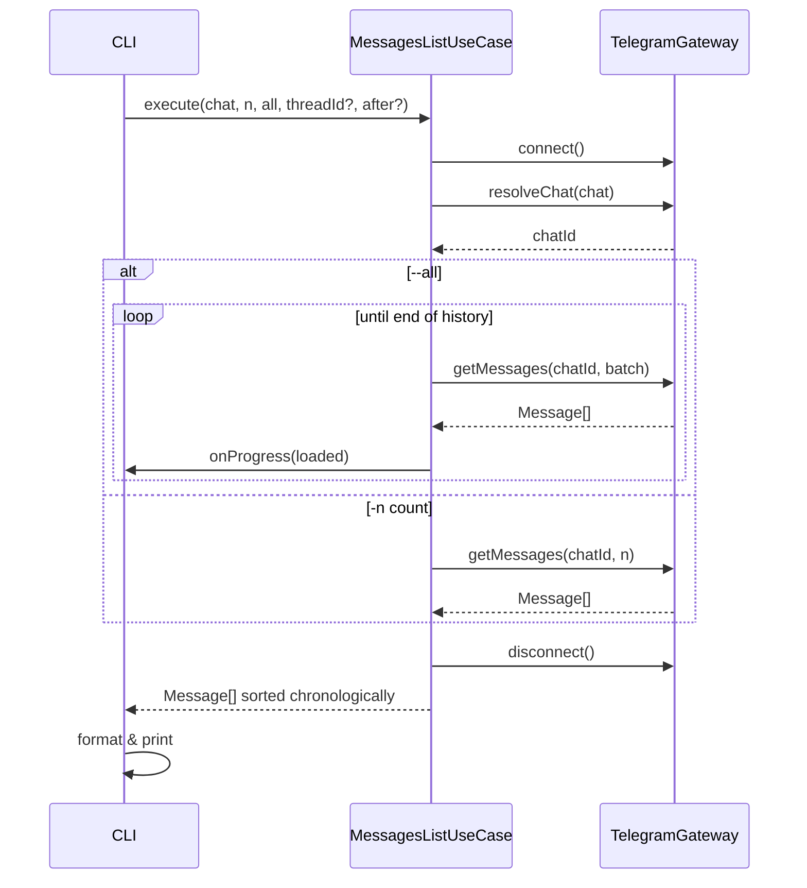

# Messages List

Выводит список сообщений из указанного чата.

## Команда CLI

```bash
tg messages <chat> [-n <count>] [--all] [--topic <id>] [--after <datetime>]
```

## Входные параметры

| Параметр | Тип | По умолчанию | Описание |
|---|---|---|---|
| chat | string/number (аргумент) | — | Идентификатор чата: числовой ID, username или @mention |
| -n | number (флаг) | 100 | Количество последних сообщений для загрузки |
| --all | boolean (флаг) | false | Загрузить все сообщения из чата |
| --topic | number (флаг) | — | ID forum-топика (для супергрупп-форумов). Получить ID: `tg topics <chat>` |
| --after | string (флаг) | — | Показать сообщения после указанного времени. Форматы: `2026-02-22`, `2026-02-22T10:00`, `"2026-02-22 10:00"`, `10:00` (сегодня) |
| --account | string (глобальный флаг) | default | Alias аккаунта |

## Выходные данные

Список сообщений в хронологическом порядке (от старых к новым):

```
[2026-02-22 10:15] #42 Иван Иванов:
  Привет! Как дела?

[2026-02-22 10:16] #43 Пётр Петров:
  > Привет! Как дела?
  Всё хорошо, спасибо!

[2026-02-22 10:17] #44 Пётр Петров:
  [Photo]
```

В JSON-режиме (`--json`):

```json
[
  {
    "id": 42,
    "chatId": -1001234567890,
    "senderName": "Иван Иванов",
    "text": "Привет! Как дела?",
    "links": [],
    "date": "2026-02-22T10:15:00Z",
    "media": null,
    "replyToId": null,
    "isOutgoing": false
  }
]
```

Скрытые и видимые URL сохраняются в `links`, включая ссылки в подписях к медиа.
Например, для текста `See the runbook` со ссылкой на слове `runbook` поля имеют вид:

```json
{
  "text": "See the runbook",
  "links": [
    { "kind": "text_link", "offset": 8, "length": 7, "text": "runbook", "url": "https://example.com/runbook" }
  ]
}
```

В терминале: `See the runbook (https://example.com/runbook)`. Полный контракт
диапазонов и отображения описан в [Message](../entities/message.md).

## Основной сценарий



1. Определить активный аккаунт.
2. Загрузить сессию, подключиться через TelegramGateway.
3. Резолвить `chat` — найти чат по числовому ID, username или @mention. Числовые строки автоматически преобразуются в число для поддержки групп/супергрупп.
4. Если указан `--topic` — загрузить сообщения из конкретного forum-топика через `searchMessages`. Иначе — из основного чата через `getHistory`.
5. Загрузить сообщения: если `--all` — итеративно до конца истории; иначе — последние `-n` штук.
6. Если указан `--after` — отфильтровать сообщения, оставив только те, что отправлены после указанного времени. При итерации от новых к старым, остановить загрузку, встретив сообщение старше `--after` (оптимизация).
7. Преобразовать в массив Message-сущностей.
8. Отсортировать хронологически (от старых к новым).
9. Отформатировать и вывести.

## Ошибки

| Ситуация | Сообщение | Exit code |
|---|---|---|
| Не указан чат | `Usage: tg messages <chat> [-n count] [--all] [--topic <id>] [--after <datetime>]` | 1 |
| Неверный формат `--after` | `Invalid date format. Use: YYYY-MM-DD, YYYY-MM-DDTHH:mm, or HH:mm` | 1 |
| Топик не найден | `Topic #42 not found in this chat` | 1 |
| Чат не является форумом | `Chat is not a forum. Remove --topic flag.` | 1 |
| Чат не найден | `Chat "xxx" not found` | 1 |
| Не задан default-аккаунт | `No default account. Use 'tg default <alias>' or --account flag.` | 2 |
| Сессия истекла | `Session expired for "work". Run 'tg auth' to re-authenticate.` | 2 |

## Граничные случаи

- `--all` для чатов с большой историей: выводить прогресс загрузки `Loading messages... 1500 loaded`.
- Сообщение-ответ (reply): отображать цитату оригинального сообщения с `>`.
- Сообщение только с медиа (без текста): отображать плейсхолдер `[Photo]`, `[Document: file.pdf]` и т.д.
- `-n 0`: вывести пустой результат без ошибки.
- Удалённые сообщения: пропускать, не выводить.
- Forum-топик: `tg messages -1001234567890 --topic 42` — загрузить сообщения из топика #42. Для получения списка топиков: `tg topics <chat>`.
- `--after "10:00"` — показать сообщения за сегодня с 10:00.
- `--after 2026-02-22` — показать сообщения с начала дня 22 февраля.
- `--after` + `-n` — сначала применяется фильтр по дате, потом лимит (показать последние N сообщений после указанного времени).
