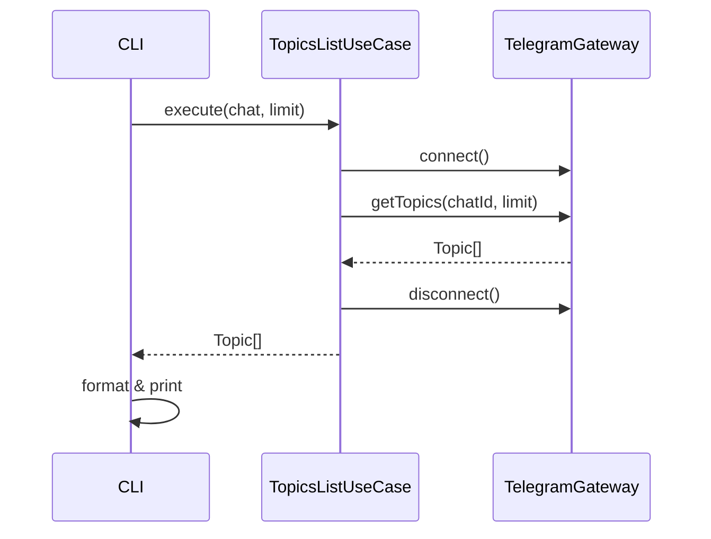

# Topics List

Выводит список forum-топиков в супергруппе.

## Команда CLI

```bash
tg topics <chat> [--limit <n>]
```

## Входные параметры

| Параметр | Тип | По умолчанию | Описание |
|---|---|---|---|
| chat | string/number (аргумент) | — | Идентификатор чата: числовой ID или username |
| --limit | number (флаг) | 100 | Количество топиков для вывода |
| --account | string (глобальный флаг) | default | Alias аккаунта |

## Выходные данные

Таблица топиков:

```
  #  Topic ID  Title                Unread  Status
  1  1         General              3       open pinned
  2  42        Bugs                 0       open
  3  85        Feature Requests     5       open
  4  90        Archive              —       closed
```

В JSON-режиме (`--json`):

```json
[
  {
    "id": 1,
    "title": "General",
    "unreadCount": 3,
    "isClosed": false,
    "isPinned": true
  }
]
```

## Основной сценарий



1. Определить активный аккаунт.
2. Подключиться через TelegramGateway.
3. Запросить список топиков через `iterForumTopics`.
4. Преобразовать в массив Topic-сущностей.
5. Отформатировать и вывести.

## Ошибки

| Ситуация | Сообщение | Exit code |
|---|---|---|
| Не указан чат | `Usage: tg topics <chat> [--limit <n>]` | 1 |
| Чат не найден | `Chat "xxx" not found` | 1 |
| Чат не является форумом | `Chat is not a forum supergroup` | 1 |
| Не задан default-аккаунт | `No default account. Use 'tg default <alias>' or --account flag.` | 2 |

## Граничные случаи

- Супергруппа без включённого форума: вывести ошибку `Chat is not a forum supergroup`.
- Нет топиков (только General): вывести таблицу с одним General-топиком.
- Использование совместно с messages: `tg topics --limit 100 -- -1001234567890`, затем `tg messages --topic 42 -- -1001234567890`.
- Для имени сопоставить `Message.topicId` с `Topic.id` из списка того же `Message.chatId`.
  Идентификаторы топиков могут совпадать между чатами. Лимит по умолчанию 100 можно
  увеличить явно, например до 200, без автоматического обхода всех топиков.
- Переименование или закрытие не меняет ID. Удалённое, недоступное или не вошедшее
  в ограниченную выдачу имя не отменяет достоверный `Message.topicId`.
